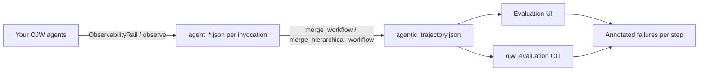

# Agent Framework guide: observe and evaluate any OpenJiuwen agent

Observability and Evaluation also works as a **standalone Python module**. Any
native agent built with the OpenJiuwen (OJW) framework can be instrumented with
a few lines of code, without changing how the agent is built or run:

1. **Record**: attach an `ObservabilityRail` (or call `observe()`) before invoking
   your agent. Each invocation is saved as a structured JSON trajectory.
2. **Export**: after the run, merge the recordings into one
   `agentic_trajectory.json`.
3. **Evaluate**: an LLM judge finds failing steps, either in a local web UI or
   from the terminal.



Your application keeps full control: it creates and configures its agents, runs
them, and decides when to export and evaluate.

> Using the JiuwenSwarm (i.e., HyperAgent) chat app instead? Follow the
> [JiuwenSwarm guide](JIUWENSWARM_PLUGIN_GUIDE.md). Judge providers, result files,
> remote access and troubleshooting are shared by both and described in the
> [Evaluation reference](EVALUATION_REFERENCE.md).

**Contents:** [1. Requirements](#1-requirements) ·
[2. Install](#2-install) · [3. Quickstart](#3-quickstart) ·
[4. Record your agents](#4-record-your-agents) ·
[5. Export a completed run](#5-export-a-completed-run) ·
[6. Evaluate](#6-evaluate) · [7. Checklist for your application](#7-checklist-for-your-application) ·
[8. Troubleshooting](#8-troubleshooting)

## 1. Requirements

| | |
| --- | --- |
| OS | Linux or WSL (the evaluation service uses Unix file locking) |
| Python | 3.11 or later (tested: 3.11) |
| Framework | OpenJiuwen `0.1.19`, with OpenTelemetry `1.41.1` (installed for you) |
| Your agents | `ReActAgent` or `DeepAgent`, called through `invoke()` |
| Judge | An API key for one judge provider: OpenAI, OpenRouter, or MLOps |

The agents' model credentials and the judge's credentials are independent; they
can use different providers.

## 2. Install

Run these from the repository root. Create a fresh environment, or use the one
that runs your application.

**With pip:**

```bash
python3.11 -m venv .venv
source .venv/bin/activate
python -m pip install -e ./packaging/observability-and-evaluation
```

**With uv** (uv environments have no `pip`, so use `uv pip`):

```bash
uv venv --python 3.11 .venv
source .venv/bin/activate
uv pip install -e ./packaging/observability-and-evaluation
```

`-e` (editable) links the installed modules to this checkout, so keep the
checkout in place. Drop `-e` for a regular install.

This installs two Python modules and two commands:

| Name | What it is |
| --- | --- |
| `ojw_observability` | Recording and export API |
| `ojw_evaluation` | Evaluation API, and the `ojw_evaluation` CLI |
| `ojw-evaluation-ui` | Command to manage the local evaluation UI service |

**Verify.** Run this from outside the checkout, so Python cannot pick up source
files from the current directory by accident:

```bash
cd /tmp
python -c 'import ojw_observability as o; print(o.__file__)'
ojw_evaluation --help
ojw-evaluation-ui --help
python -m pip check        # with uv: uv pip check
```

The printed path should end in
`plugins/observability-and-evaluation/rails/observability/__init__.py` inside your
checkout (for an editable install), and the dependency check should report no
conflicts.

## 3. Quickstart

[`examples/quickstart.py`](examples/quickstart.py) is a complete, runnable
example: two ReActAgents (a writer with one tool, then a reviewer) are recorded,
exported, and the evaluation command is printed. It works with any
OpenAI-compatible model endpoint.

```bash
export AGENT_API_KEY='your-model-key'
export AGENT_API_BASE=https://openrouter.ai/api/v1
export AGENT_MODEL=qwen/qwen3-32b
python docs/plugins/observability-and-evaluation/examples/quickstart.py
```

Expected result:

```text
runs/<timestamp>/
├── agent_Writer_<id>.json             # one recording per invocation
├── agent_Writer_<id>.transcript.jsonl
├── agent_Writer_<id>.events.jsonl
├── agent_Reviewer_<id>.json
├── ...
└── agentic_trajectory.json            # the exported run: evaluate this file

Trajectory saved: /…/runs/<timestamp>/agentic_trajectory.json
```

Only these lines in the example are plugin-specific; everything else is ordinary
OpenJiuwen code:

```python
from ojw_observability import ObservabilityRail, merge_workflow

rail = ObservabilityRail().configure(output_dir=run_dir)   # before invoke
await agent.register_rail(rail)
try:
    response = await agent.invoke({"query": query, "conversation_id": uuid4().hex})
finally:
    await agent.unregister_rail(rail)

trajectory = merge_workflow(                                # after all agents finished
    sorted(run_dir.glob("agent_*.json")),
    run_dir / "agentic_trajectory.json",
    scenario_meta={"uc": "Quickstart", "scenario": "WriteAndReview",
                   "system_architecture": "sequential"},
)
```

Now evaluate it (see [section 6](#6-evaluate)):

```bash
export OPENROUTER_API_KEY='your-judge-key'
ojw_evaluation run failure-detector --strategy taxonomy-guided --taxonomy ours \
  --client openrouter --model-id '<judge-model-id>' \
  --trajectory runs/<timestamp>/agentic_trajectory.json
```

The rest of this guide explains each step so you can apply it to your own agents.

## 4. Record your agents

Configure the agent completely (model, prompts, tools) first, then attach
recording. There are two equivalent ways; pick **one** per agent.

| | `ObservabilityRail` (recommended) | `observe()` |
| --- | --- | --- |
| Style | OpenJiuwen Rail: `register_rail` / `unregister_rail` | Function that wraps the agent instance in place |
| Agents | `ReActAgent`, `DeepAgent` | Any agent with async `invoke()`, Rail registration, and an agent card |
| Model calls | Non-streaming by default | Your invocation settings by default |
| Use when | You already use Rails, or you use DeepAgent | You want the shortest change |

### Option A: `ObservabilityRail`

```python
from uuid import uuid4
from ojw_observability import ObservabilityRail


async def invoke_observed(agent, query, run_dir):
    rail = ObservabilityRail().configure(output_dir=run_dir)
    await agent.register_rail(rail)
    try:
        return await agent.invoke({"query": query, "conversation_id": uuid4().hex})
    finally:
        await agent.unregister_rail(rail)
```

- Use a **new Rail instance per agent**. Configure it before registering it.
- For `ReActAgent`, `output_dir` is required.
- For `DeepAgent`, `output_dir` is optional: without it, recordings go to
  `<workspace>/observability_traces/<session>/`.
- To keep your agent's own streaming setting, use
  `.configure(output_dir=run_dir, force_non_streaming=False)`.

### Option B: `observe()`

```python
from uuid import uuid4
from ojw_observability import observe, unobserve


async def invoke_observed(agent, query, run_dir):
    observe(agent, output_dir=run_dir)          # synchronous; output_dir is required
    try:
        return await agent.invoke({"query": query, "conversation_id": uuid4().hex})
    finally:
        unobserve(agent)
```

`observe()` keeps your invocation settings by default. Pass
`force_non_streaming=True` to request non-streaming model calls from a ReActAgent.

### Rules for both options

- **One fresh `output_dir` per workflow run.** All agents of a run write to the
  same directory; never reuse it for another run.
- **Only `invoke()` is recorded**, not `stream()`.
- **Detaching is safe.** `unregister_rail` / `unobserve` restores the original
  `invoke()`; a recording that is still being written finishes normally.
- **Missing dependencies don't crash your agent.** Recording is skipped and the
  Rail's `last_error` explains which package to install.

## 5. Export a completed run

Each invocation produces one `agent_*.json` file (schema version `2.0.0`) plus
transcript and event files. After **all** invocations of the run have finished,
merge them into one `agentic_trajectory.json`. Pass only that run's files: the
exporter cannot detect missing recordings or separate two runs mixed together.

### Choose the exporter

| Your workflow | `system_architecture` | Exporter |
| --- | --- | --- |
| Agents run one after another, each with its own context | `sequential` | `merge_workflow` |
| Agents run one after another and **share one conversation history** | `shared_context` | `merge_workflow` |
| The same agents run repeatedly, e.g. a write → test → retry loop | `looping` | `merge_workflow` |
| A planner or orchestrator **delegates** to specialist agents (nested invocations) | `hierarchical` | `merge_hierarchical_workflow` |

`merge_workflow` requires invocations that don't overlap in time; it rejects
nested invocations and points you to the hierarchical exporter.

### Sequential, shared-context, and looping workflows

```python
from ojw_observability import merge_workflow

trajectory = merge_workflow(
    sorted(run_dir.glob("agent_*.json")),
    run_dir / "agentic_trajectory.json",
    scenario_meta={
        "uc": "Science",                        # your application / use case
        "scenario": "LiteratureReview",         # your workflow
        "system_architecture": "sequential",    # or "shared_context" / "looping"
    },
    run_metadata={"research_topic": topic},     # optional, see below
)
```

It returns the `Path` of the written file. Invocations are ordered by start time
and steps are renumbered across the whole run; repeated invocations of the same
agent (loops) are all kept. Source files are not modified.

**Metadata** is optional and only labels the trajectory; timing, token counts,
agent order, tools and status are always taken from the recordings.

| Argument | Values | Default |
| --- | --- | --- |
| `scenario_meta["uc"]` | Application or use-case label | `"unknown_UC"` |
| `scenario_meta["scenario"]` | Workflow name | `"sequential_workflow"` |
| `scenario_meta["system_architecture"]` | `sequential`, `shared_context`, `looping` | `sequential` |
| `scenario_meta["system_architecture_description"]` | Free-text description of the workflow | generic description |
| `scenario_meta["framework"]` | Must be `"OJW"` | `"OJW"` |
| `run_metadata["research_topic"]` | Topic string, for topic-driven tasks | `null` |
| `run_metadata["dataset"]`, `run_metadata["index_num"]` | Dataset name and integer task index, for benchmark tasks | `null` |
| `run_nr` | Run number shown in the trajectory | `1` |

Other keys are ignored.

### Hierarchical (delegation) workflows

```python
from ojw_observability import merge_hierarchical_workflow

trajectory = merge_hierarchical_workflow(
    sorted(run_dir.glob("agent_*.json")),
    run_dir,                                     # output directory
    task=task,                                   # the task given to the planner
    plan=plan,                                   # the orchestration plan it produced
    provided_agents=[agent.card for agent in specialists],
    scenario_meta={"uc": "Science", "scenario": "DelegatedReview"},
)
```

- `provided_agents`: the native cards of **all available specialists**, whether
  or not they were called. Don't include the planner, supervisor or final-answer
  agent.
- Pass the complete run's recordings, so that skipped specialists can be
  told apart from missing files.
- It writes `OrchestratorObj_*.json` and `agentic_trajectory.json` into `run_dir`,
  returns the trajectory path, and refuses to overwrite existing outputs.

## 6. Evaluate

Evaluation reads the saved trajectory; it never reruns your agents. The judge is
an LLM of your choice; the full trajectory is sent to it (see
[Data and cost](EVALUATION_REFERENCE.md#data-privacy-and-cost)).

### In the local UI

Open the UI from your application right after export:

```python
try:
    from ojw_evaluation import open_evaluation_ui

    url = await open_evaluation_ui(
        trajectory,                  # path returned by the exporter
        workspace=run_dir.parent,    # share one UI service across runs
        name="Science literature review",
        open_browser=False,          # True: open a browser on this machine
    )
    print(f"Open evaluation: {url}")
except Exception as exc:              # the trajectory stays usable if the UI can't start
    print(f"Evaluation UI unavailable ({type(exc).__name__}). Trajectory: {trajectory}")
```

| Argument | Meaning | Default |
| --- | --- | --- |
| `trajectory_path` | The exported file | required |
| `workspace` | Where the UI service keeps its state (`<workspace>/evaluation_ui/`). Use `run_dir.parent` to share one service across runs, or `run_dir` for one per run. | the trajectory's folder |
| `name` | Display name in the UI | the trajectory's folder name |
| `open_browser` | Open a browser on the machine running Python | `True` |
| `port` | Preferred service port; the actual one is in the returned URL | `8765` |

Then:

1. Open the **full** URL, including everything after `#` (it carries an access
   token). The terminal also logs it as **Evaluation UI ready:**. On a remote
   machine, forward the port first: see
   [Remote access](EVALUATION_REFERENCE.md#remote-access).
2. In **Setup**, check the trajectory, choose the judge provider and model, the
   method and taxonomy, and enter the judge API key.
3. Press **Run evaluation**. Opening the UI alone never starts an evaluation.

The UI service keeps running after your application exits. To reopen a saved
trajectory later, call `open_evaluation_ui(path)` again from any script.

### From the terminal

The CLI reads the judge key **only from environment variables**; it doesn't load
`.env` files.

```bash
export OPENROUTER_API_KEY='your-judge-key'
ojw_evaluation run failure-detector \
  --strategy taxonomy-guided --taxonomy ours \
  --client openrouter --model-id '<judge-model-id>' \
  --trajectory /absolute/path/to/agentic_trajectory.json
```

Exit code `0` means the evaluation completed. Results are saved next to the
trajectory in `evaluation/<UTC-timestamp>_terminal/`, and also appear in the UI
under **Previous evaluations**.

Providers, strategies (`taxonomy-guided` with `ours` = RAMS or `mast`, or
`zero-shot`), all CLI options, and the result files are described in the
[Evaluation reference](EVALUATION_REFERENCE.md).

## 7. Checklist for your application

- [ ] Each workflow run gets a **new** output directory.
- [ ] Every agent you want evaluated has its **own** Rail (or `observe()`), attached
      before `invoke()` and detached in `finally`.
- [ ] Export runs **after** the last agent finishes, with only that run's files,
      using the exporter that matches your architecture.
- [ ] Opening the UI is wrapped in `try`/`except`, so a UI problem never loses
      the trajectory.
- [ ] In an async application, `await open_evaluation_ui(...)`; don't call
      `asyncio.run()` inside a running event loop.

## 8. Troubleshooting

| Symptom | Likely cause | Fix |
| --- | --- | --- |
| `ValueError: Configure output_dir before registering ObservabilityRail on ReActAgent` | No `output_dir` for a ReActAgent | `.configure(output_dir=run_dir)` before `register_rail` |
| No `agent_*.json` files after the run | Agent called with `stream()`, or the Rail was registered on a different agent instance | Use `invoke()`; register on the instance you invoke |
| Rail present but nothing recorded; `rail.last_error` mentions a dependency | Plugin requirements missing in this environment | Install `plugins/observability-and-evaluation/requirements.txt` into the environment running your app |
| `ValueError: Nested agent invocations require a hierarchical workflow exporter` | Agents called other agents | Use `merge_hierarchical_workflow` |
| `ValueError: Overlapping invocations do not form a sequential workflow` | Agents ran in parallel, or files from two runs were mixed | Use one directory per run; pass only that run's files |
| `FrameworkError … SAFE_CERT_DIR is not set` from OpenJiuwen | OpenJiuwen needs this variable when `verify_ssl=True` | Set it to the folder of your CA bundle, as in the quickstart |
| `ModuleNotFoundError: ojw_observability` | Different Python environment | Activate the environment where you installed the package |

Evaluation errors (`ValueError`, `APIConnectionError`, UI link problems) are in
the [shared troubleshooting table](EVALUATION_REFERENCE.md#troubleshooting).
