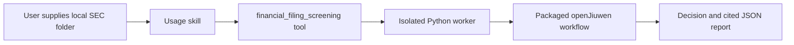

# Financial Filing Screening / 财报证据筛查

Run the fixed openJiuwen SEC HTML screening workflow demonstrated in the
financial-workflow versus WorkSwarm comparison. It retains the financial checks,
risk assessments, decision reasons and source evidence in a JSON report.

读取本地 SEC 年报目录，以模型提取证据、Python 执行计算和规则，输出含来源引用的
REVIEW / REJECT 结果；风险覆盖不完整时保留 UNVERIFIED。证据缺失时停止，不猜测。采用 Apache-2.0 许可证。

**Version 0.1.2, Apache-2.0.** Installed and tested in WorkSwarm 0.2.7.beta1.
Actual chat inspection and Qwen3-14B screening pass on Caterpillar FY2024, with
90 repository tests and 131 independent report checks. The expected REJECT
result retains regulatory UNVERIFIED and supply-chain FLAG evidence. This is
single-filing acceptance; no general accuracy or speed claim is made.
No Hub publication is claimed.

## Capabilities

- `inspect`: read the cover identity and available report titles without inference.
- `screen`: run the HTML ingestion, statement selection, evidence retrieval,
  metric extraction, deterministic calculations, risk assessment, policy and
  provenance stages from the demonstrated workflow.
- Output: `report.json` with the native workflow result and extracted financial
  values with their evidence; `result.json` with
  execution status and a concise summary; `runtime.log` for local diagnosis.



The package has one skill and one tool. A lifecycle rail is not required.
The research tester, WorkSwarm runners, videos, model weights, credentials,
private filing bundles and XBRL scoring data are not bundled.

## Setup

The host needs the current JiuwenSwarm plugin loader and `Tool` / `ToolCard` API.
Host loading is verified with WorkSwarm 0.2.7.beta1 / SDK 0.1.18.post1.
SDK 0.1.17.post1 uses an older manifest schema and is **not** a supported host
loader for this package.
The financial workflow uses an isolated **Python 3.11** environment because it
is pinned to `openjiuwen==0.1.17.post1`; do not replace the host's SDK version.

Create a separate environment outside the plugin directory and install the
dependencies from the installed package (replace `/path/to/...` paths):

```sh
python3.11 -m venv /path/to/screening-venv
/path/to/screening-venv/bin/python -m pip install -r /path/to/financial-filing-screening/runtime/requirements.txt
export FINANCIAL_SCREENING_PYTHON=/path/to/screening-venv/bin/python
```

Set this variable in the environment of the JiuwenSwarm process and restart it.
For WorkSwarm Desktop, add it to the existing `~/.jiuwenswarm/config/.env`
without changing other settings. Select the plugin from **Add file → Extensions
→ Plugins** in a new chat. Local development packages are registered with the
WorkSwarm-provided `plugin-creator/scripts/register_plugin.py` helper.
On Windows, the interpreter is `screening-venv\Scripts\python.exe`; Windows
execution has not been verified. Dependency installation requires network access.

For screening, an operator must separately configure an already running local
OpenAI-compatible model at **http://127.0.0.1:11434/v1**. The recorded comparison
used Qwen3-14B served by vLLM with structured-output support. Set its exact
served model ID and explicitly enable inference in the host environment:

```sh
export FINANCIAL_SCREENING_MODEL=Qwen3-14B
export FINANCIAL_SCREENING_ALLOW_INFERENCE=1
```

The WorkSwarm chat model and the workflow extraction model have separate
connections. Local Qwen3-14B extraction explicitly selects its non-thinking
chat template with strict JSON-schema output. Operating cash flow is defined as
the reported net cash from operating activities. Other model/provider settings are not
changed. Inspect itself uses zero model calls, but starting it through a
chat still requires a working chat model to select the tool.

This release keeps the demo's loopback endpoint restriction. An approved server
can be reached through an independently configured tunnel. The plugin does not
start models, download weights, allocate GPUs, inherit cloud credentials or fall
back to a paid service. A plain Ollama installation is not independently verified;
the original loader's `ollama` setting selects its OpenAI-compatible local path.

## Inputs and usage

Provide one locally stored SEC rendered filing containing `FilingSummary.xml`
and every referenced `R<number>.htm` / `.html` file. Missing files and links outside
the folder are refused. This first plugin entry point accepts HTML folders only.
English, USD, US-GAAP statements are the demonstrated scope.

Inspect first:

```json
{"mode":"inspect","filing_dir":"/path/to/filing","output_dir":"/path/to/results/inspect-001"}
```

Then screen with a **new** output directory:

```json
{"mode":"screen","filing_dir":"/path/to/filing","output_dir":"/path/to/results/screen-001","timeout_seconds":900}
```

The parent `/path/to/results` must already exist. Output directories cannot be
inside the plugin or the input filing. Existing outputs are never overwritten.
Files are treated as local data; ingestion does not execute HTML scripts or fetch
web content. Inspect mode returns no decision. An execution failure also returns
no decision. The timeout limits wall time, not tokens or cost. The tool declares a 930-second
host deadline so WorkSwarm does not cancel a valid 900-second worker early.

## Example policy

| Criterion | PASS | FLAG | FAIL |
|---|---|---|---|
| Revenue growth | At least 0% | — | Below 0% |
| Operating margin | At least 10% | Above 0%, below 10% | At most 0% |
| Operating cash flow | Positive | — | Zero or negative |
| Liabilities / assets | At most 80% | Above 80%, at most 100% | Above 100% |
| Balance sheet | Reconciles under the workflow's equity handling | — | Does not reconcile |

Any failed financial criterion produces REJECT. Otherwise financial FLAG or
regulatory/supply-chain FLAG or UNVERIFIED produces REVIEW. Otherwise PASS.
The HTML entry point treats a model CLEAR assessment as UNVERIFIED overall:
rendered statements and notes provide selected disclosures, not complete risk
coverage. It preserves the cited passage and the model rationale for review.
Consequently this entry point produces REVIEW or REJECT; PASS is reserved for
a workflow with complete risk coverage.
Missing required financial evidence stops execution. Thresholds are fixed to the
demo defaults in this release; they are example policy choices, not regulations.

## Limits and handling reports

The packaged application is a hash-recorded snapshot of the corrected HTML
workflow, with two documented extraction and citation adaptations in 0.1.2, not the
earlier public PDF prototype. `source-manifest.json` records both the original
and packaged hashes for the changed file. The demo's financial-value
observer is retained to save extracted numbers. Its terminal display, server-wide
token counters and benchmark scoring are not needed at runtime.
Historical comparison results do not predict this installation's speed
or accuracy. No fresh live-model result is claimed by packaging alone.

The underlying prototype has known limits involving period selection, ambiguous
equity, missing or confusing evidence and incomplete risk coverage in rendered
report bundles. Citations verify source text, not complete semantic correctness.
Human review remains necessary. This tool does not make investments, credit
decisions or regulatory certifications.

Reports and SDK logs may contain document content. Keep output directories
private; do not upload them to the Hub or paste logs into public issues.

## Package structure

```text
financial-filing-screening/
  manifest.json
  README.md
  LICENSE
  LICENSE_STATUS.md
  source-manifest.json
  skills/financial-filing-screening/SKILL.md
  tools/financial_screening_tool.py
  runtime/run_filing.py
  runtime/requirements.txt
  runtime/screening/             # application snapshot only
```

The tool starts a fixed worker with an argument list, without a shell. Only an
operator-controlled interpreter path can select executable code. Nothing starts
at tool import or construction. All generated files go to the supplied output
directory. See `LICENSE` and `LICENSE_STATUS.md` for licensing.

## Maintainer validation

From the repository root, use a separate Python 3.11 environment:

```sh
python -m pip install -r tests/plugins/financial-filing-screening/requirements-test.txt
python scripts/pr_check.py
python scripts/validate.py financial-filing-screening --require-hot-load
python scripts/build.py financial-filing-screening
```

The repository validator checks component imports and construction. To exercise
the real host load/invoke/unload chain, run
`tests/plugins/financial-filing-screening/smoke_host.py` in an SDK 0.1.18.post1
host environment, with absolute `--package`, `--filing-dir` and `--output-dir`
arguments and `FINANCIAL_SCREENING_PYTHON` pointing to the separate workflow
environment. Its default mode is `inspect`; `--mode screen` requires the real
configured model. It does not simulate model responses.

The offline suite uses explicitly controlled model responses to check the real
workflow graph. These results do not establish live model accuracy.
