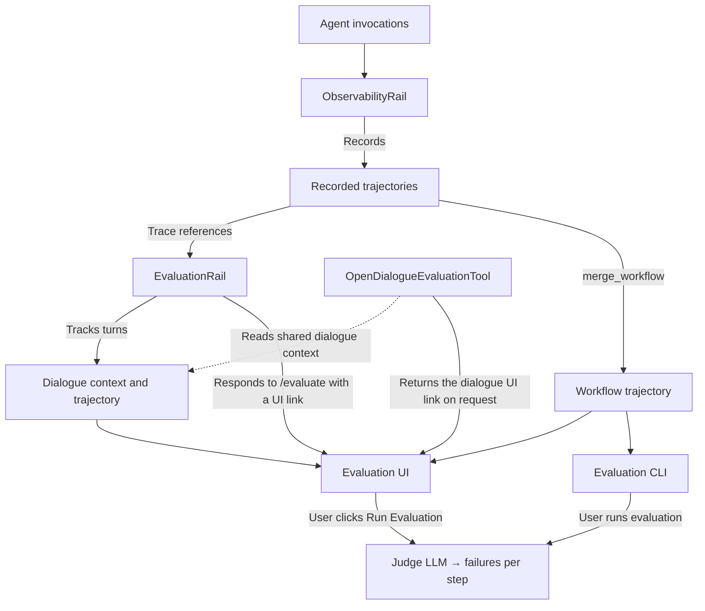

# Observability and Evaluation / 可观测与评估

**Authors:** Ana Petrovska, Feng Liu, Mikhail Tiuterev, Maria Waheed, Driton Salihu

**Department:** R&D Engineering and Security Technology Lab, Heisenberg Research Center

[English](#english) · [中文](#中文)

## English

Record what your OpenJiuwen agents do, and let an LLM judge find the steps where
they fail. Works inside the **JiuwenSwarm (i.e., HyperAgent)** chat app, and as a
**standalone Python module** for any agent built with the OpenJiuwen (OJW)
framework. The recorder, evaluator, web UI and failure taxonomies are bundled.



### Choose your path

| You want to… | Follow |
| --- | --- |
| Evaluate chats in **JiuwenSwarm (i.e., HyperAgent)** | [JiuwenSwarm guide](https://gitcode.com/openJiuwen/agent-plugin/blob/main/docs/plugins/observability-and-evaluation/JIUWENSWARM_PLUGIN_GUIDE.md) |
| Instrument and evaluate **your own OpenJiuwen agents** | [Agent Framework guide](https://gitcode.com/openJiuwen/agent-plugin/blob/main/docs/plugins/observability-and-evaluation/AGENT_FRAMEWORK_PLUGIN_GUIDE.md) |
| Look up judge providers, result files, remote access, troubleshooting | [Evaluation reference](https://gitcode.com/openJiuwen/agent-plugin/blob/main/docs/plugins/observability-and-evaluation/EVALUATION_REFERENCE.md) |

### At a glance: JiuwenSwarm chat

After [installing the plugin and its dependencies](https://gitcode.com/openJiuwen/agent-plugin/blob/main/docs/plugins/observability-and-evaluation/JIUWENSWARM_PLUGIN_GUIDE.md):

1. Select **Observability and Evaluation** for a chat and send a message.
2. Send `/evaluate` as a separate message (type it in full).
3. Open the complete returned link, including everything after `#`.
4. Enter the judge model and API key and press **Run evaluation**.

### At a glance: your own OpenJiuwen agents

```bash
pip install -e ./packaging/observability-and-evaluation    # from the repository root
```

```python
from ojw_observability import ObservabilityRail, merge_workflow

rail = ObservabilityRail().configure(output_dir=run_dir)
await agent.register_rail(rail)
try:
    await agent.invoke({"query": query, "conversation_id": conversation_id})
finally:
    await agent.unregister_rail(rail)

trajectory = merge_workflow(sorted(run_dir.glob("agent_*.json")),
                            run_dir / "agentic_trajectory.json")
```

```bash
export OPENROUTER_API_KEY=...
ojw_evaluation run failure-detector --client openrouter --model-id <judge-model> \
  --trajectory /path/to/agentic_trajectory.json
```

A complete runnable example is in the
[Agent Framework guide](https://gitcode.com/openJiuwen/agent-plugin/blob/main/docs/plugins/observability-and-evaluation/AGENT_FRAMEWORK_PLUGIN_GUIDE.md#3-quickstart).

### Components

| Component | Role |
| --- | --- |
| `ObservabilityRail` | Records each agent invocation as a structured trajectory |
| `EvaluationRail` | JiuwenSwarm: keeps one trajectory per dialogue and answers `/evaluate` with a UI link |
| `open_dialogue_evaluation` | JiuwenSwarm tool that returns the same link |
| `ojw_observability`, `ojw_evaluation` | Standalone Python modules: record, export, evaluate |
| `ojw_evaluation`, `ojw-evaluation-ui` | Standalone commands: evaluate from the terminal, manage the UI service |

### Compatibility

Tested on Linux with Python 3.11, OpenJiuwen `0.1.19`, OpenTelemetry `1.41.1`,
and JiuwenSwarm (`workswarm`) `0.2.7`. The Python dependencies are listed in
[`requirements.txt`](requirements.txt). Installing the plugin into JiuwenSwarm
does **not** install them; see the JiuwenSwarm guide.

### Package contents

```text
observability-and-evaluation/
├── manifest.json               # plugin metadata for JiuwenSwarm
├── README.md
├── requirements.txt            # Python dependencies
├── tools/open_evaluation_tool.py
└── rails/
    ├── observability_rail.py   # JiuwenSwarm entry point: recording
    ├── evaluation_rail.py      # JiuwenSwarm entry point: /evaluate
    ├── observability/          # recorder and exporters (ojw_observability)
    └── evaluation/             # evaluator, UI service, UI and taxonomies (ojw_evaluation)
```

You don't need to edit any of these files to use the plugin. Build scripts,
tests and guides are in the repository, not in the plugin ZIP.

### Good to know

- Evaluation sends the full trajectory to the judge provider you choose.
  Taxonomy-guided evaluation makes one judge call per failure category.
- Linux or WSL only. Only `invoke()` is recorded, not `stream()`.
- More in [Known limitations](https://gitcode.com/openJiuwen/agent-plugin/blob/main/docs/plugins/observability-and-evaluation/EVALUATION_REFERENCE.md#known-limitations).

## 中文

记录 OpenJiuwen 智能体的执行过程，并由 LLM 评判模型找出失败的步骤。
既可在 **JiuwenSwarm（即 HyperAgent）** 对话应用中使用，也可作为**独立 Python 模块**，
用于任何基于 OpenJiuwen（OJW）框架构建的智能体。插件已包含记录器、评估引擎、Web 界面和失败分类体系。

### 选择使用方式

| 目标 | 参阅 |
| --- | --- |
| 在 **JiuwenSwarm（即 HyperAgent）** 中评估对话 | [JiuwenSwarm 指南](https://gitcode.com/openJiuwen/agent-plugin/blob/main/docs/plugins/observability-and-evaluation/JIUWENSWARM_PLUGIN_GUIDE.md) |
| 为**自己的 OpenJiuwen 智能体**接入记录与评估 | [Agent Framework 指南](https://gitcode.com/openJiuwen/agent-plugin/blob/main/docs/plugins/observability-and-evaluation/AGENT_FRAMEWORK_PLUGIN_GUIDE.md) |
| 查阅评判模型、结果文件、远程访问与故障排查 | [评估参考](https://gitcode.com/openJiuwen/agent-plugin/blob/main/docs/plugins/observability-and-evaluation/EVALUATION_REFERENCE.md) |

### 快速了解：JiuwenSwarm 对话

[安装插件及其依赖](https://gitcode.com/openJiuwen/agent-plugin/blob/main/docs/plugins/observability-and-evaluation/JIUWENSWARM_PLUGIN_GUIDE.md)后：

1. 在对话中启用 **Observability and Evaluation**，并发送一条消息。
2. 单独发送 `/evaluate`（需完整输入，斜杠菜单中不显示）。
3. 打开返回的完整链接，保留 `#` 之后的全部内容。
4. 填写评判模型与 API 密钥，点击 **Run evaluation**。

### 快速了解：自己的 OpenJiuwen 智能体

在仓库根目录执行 `pip install -e ./packaging/observability-and-evaluation`，
在调用 `invoke()` 前注册 `ObservabilityRail`，运行结束后用 `merge_workflow` 导出
`agentic_trajectory.json`，再通过界面或 `ojw_evaluation` 命令评估。代码示例见上方英文部分，
完整可运行示例见 [Agent Framework 指南](https://gitcode.com/openJiuwen/agent-plugin/blob/main/docs/plugins/observability-and-evaluation/AGENT_FRAMEWORK_PLUGIN_GUIDE.md#3-quickstart)。

### 组件

| 组件 | 功能 |
| --- | --- |
| `ObservabilityRail` | 将每次智能体调用记录为结构化轨迹 |
| `EvaluationRail` | JiuwenSwarm：按对话保存轨迹，并以评估链接响应 `/evaluate` |
| `open_dialogue_evaluation` | JiuwenSwarm 工具，返回同样的评估链接 |
| `ojw_observability`、`ojw_evaluation` | 独立 Python 模块：记录、导出、评估 |
| `ojw_evaluation`、`ojw-evaluation-ui` | 独立命令：命令行评估、管理界面服务 |

### 兼容性

已在 Linux、Python 3.11、OpenJiuwen `0.1.19`、OpenTelemetry `1.41.1`、
JiuwenSwarm（`workswarm`）`0.2.7` 环境验证。依赖见 [`requirements.txt`](requirements.txt)；
在 JiuwenSwarm 中安装插件**不会**自动安装依赖，请参阅 JiuwenSwarm 指南。

### 注意事项

- 评估会将完整轨迹发送给所选的评判模型服务；按分类体系评估时，每个失败类别调用一次评判模型。
- 仅支持 Linux 或 WSL；仅记录 `invoke()`，不记录 `stream()`。
- 更多说明见[已知限制](https://gitcode.com/openJiuwen/agent-plugin/blob/main/docs/plugins/observability-and-evaluation/EVALUATION_REFERENCE.md#known-limitations)。
